# 400_Player (400 Media Player)

**Un lecteur multimédia moderne, écrit en 100% pur Rust, inspiré de VLC.**
Rendu GPU DirectX 12 / Vulkan, décodage multithreadé, pipeline à faible latence, interface soignée (thème « nocturne », sélecteur de skins et mode avancé), français et anglais.

> *Lumen* (la lumière) + le suffixe « 400 » demandé pour le nom — clin d'œil à la teinte 400 de la rampe de couleurs qui sert d'accent.

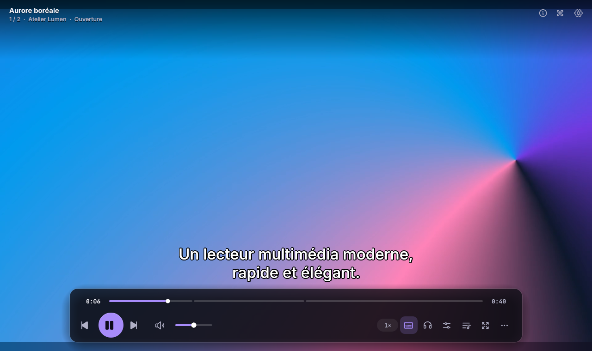

| | |
|---|---|
| **Version** | 0.1.0 — **non publiée**, pas encore empaquetée |
| **État** | Moteur, rendu, interface, sous-titres texte + image (PGS/VobSub/DVB), raccourcis (58), documentation (`docs/`), `NOTICE`, empaquetage (`.deb`/AppImage/Flatpak/`install.sh`), CI GitHub Actions et revue indépendante : **faits** ; validation et benchmarks sur matériel réel : **à faire** (voir §4 et §9) |
| **Dernière mise à jour de ce document** | 1er novembre 2026 |
| **Langage / pile** | Rust 1.97 (édition 2024) · FFmpeg 6.1 · `wgpu` 30 · `egui`/`eframe` 0.37 · `cpal` · `zbus` |
| **Taille** | 3 crates, ≈ 26 000 lignes de Rust (tests compris), **264 tests automatisés, 0 échec** |
| **Licence** | MIT **ou** Apache‑2.0, au choix (valeur par défaut posée dans `Cargo.toml` — à confirmer par vous) |

> **Indépendance.** Lumen400 est une **réécriture indépendante** : il ne reprend aucun code de VLC et n'est pas affilié à
> VideoLAN. Le dépôt de VLC n'a servi que de référence fonctionnelle (quelles fonctions un lecteur complet doit offrir).
> « VLC » est une marque de VideoLAN.

---

## Sommaire

1. [Aperçu](#1-aperçu)
2. [État d'avancement en un coup d'œil](#2-état-davancement-en-un-coup-dœil)
3. [Ce qui est fait](#3-ce-qui-est-fait)
4. [Ce qui reste à faire](#4-ce-qui-reste-à-faire)
5. [Compiler et lancer](#5-compiler-et-lancer)
6. [Raccourcis clavier](#6-raccourcis-clavier)
7. [Architecture](#7-architecture)
8. [Structure du dépôt](#8-structure-du-dépôt)
9. [Ce qui a été vérifié — et ce qui ne l'a pas été](#9-ce-qui-a-été-vérifié--et-ce-qui-ne-la-pas-été)
10. [Lumen400 face à VLC, honnêtement](#10-lumen400-face-à-vlc-honnêtement)
11. [Licences et mentions](#11-licences-et-mentions)

---

## 1. Aperçu

Toutes les captures ci‑dessous sont de **vraies** captures de la version actuelle, produites sans écran
(Xvfb + rendu Vulkan logiciel) par le pilotage automatique intégré (`--automation`, voir `docs/DEVELOPMENT.md`).

| | |
|---|---|
| 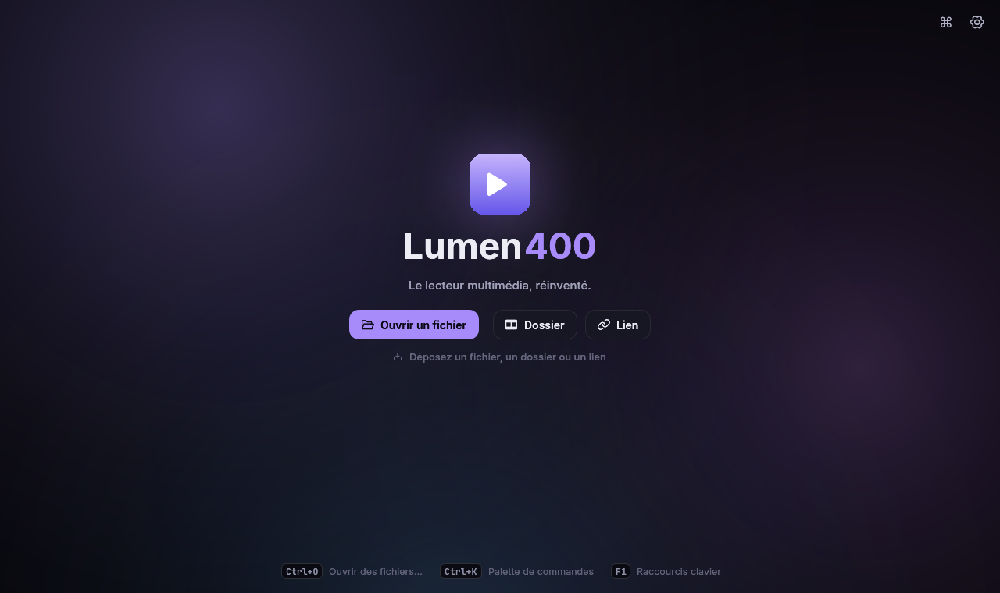 **Accueil** — ouvrir un fichier, un dossier, un lien ; glisser‑déposer | 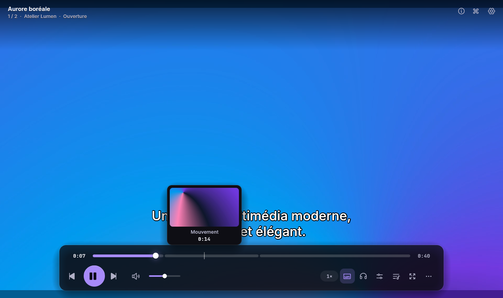 **Aperçu sur la barre de progression** + chapitres |
| 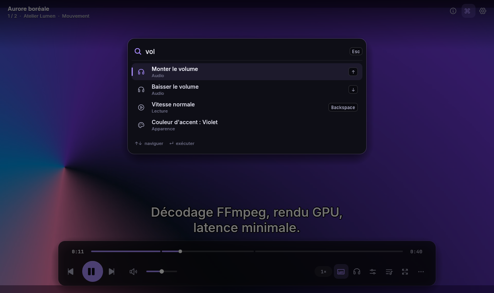 **Palette de commandes** (Ctrl+K) | 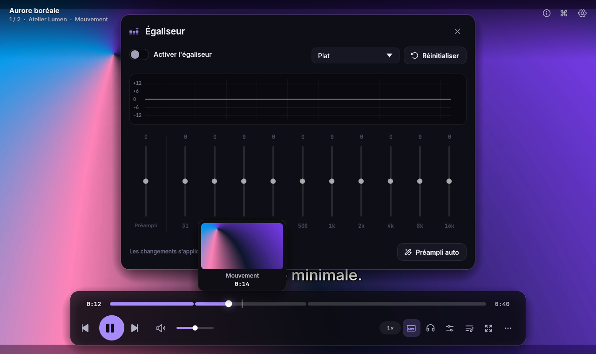 **Égaliseur 10 bandes** (Ctrl+E) |
| 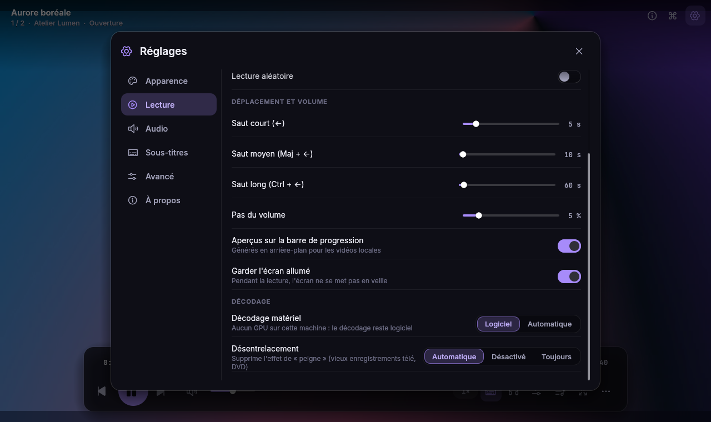 **Réglages › Lecture** (décodage, désentrelacement) | 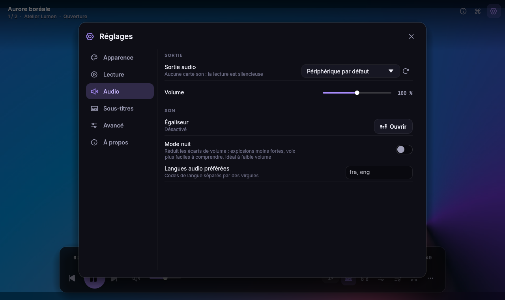 **Réglages › Audio** (mode nuit) |
| 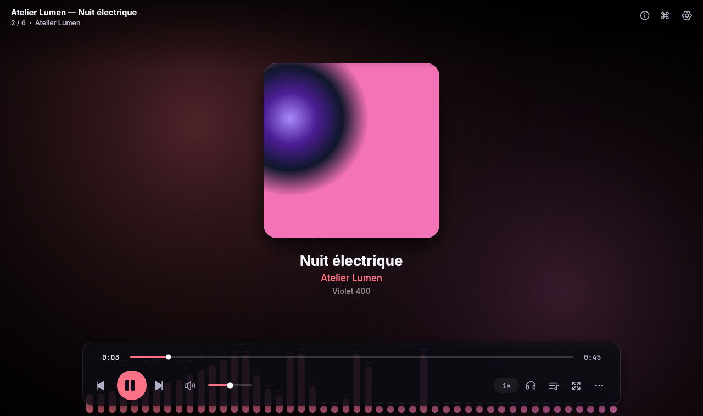 **Mode audio** : pochette + spectre (thème OLED, accent rose, interface en anglais) | 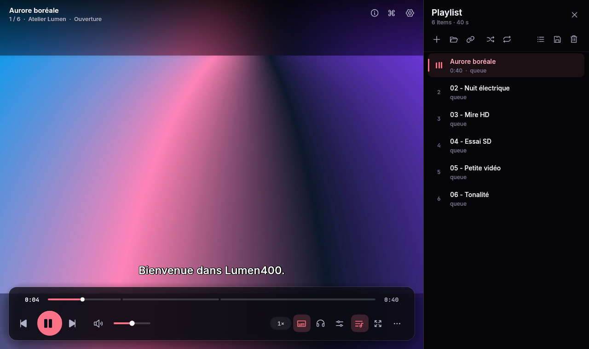 **Liste de lecture** (même thème) |
| 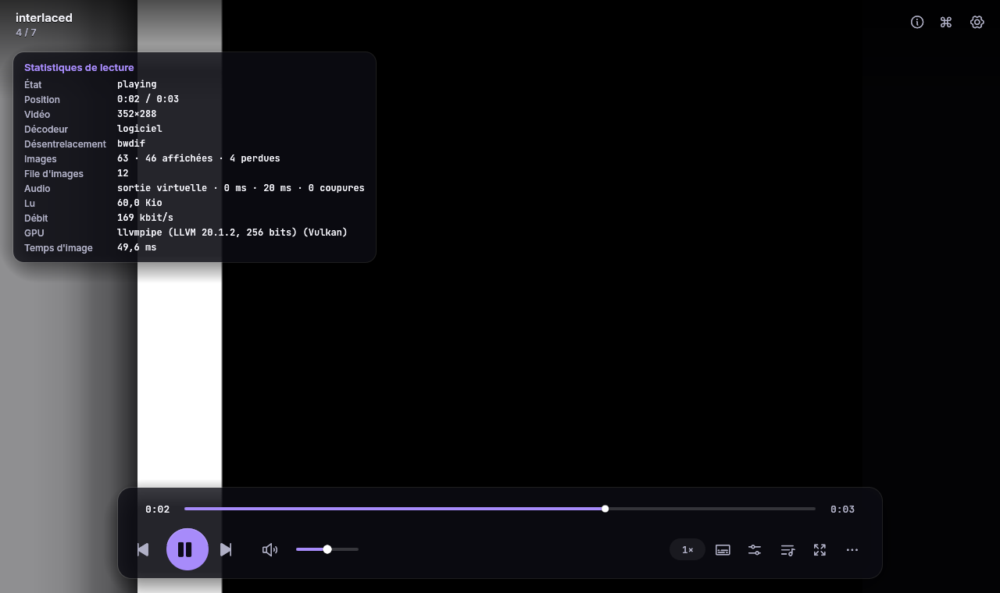 **Statistiques** (I) : le désentrelaceur actif est affiché | 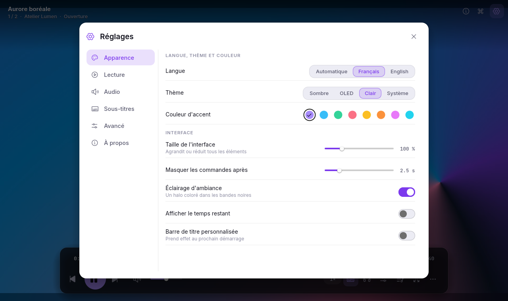 **Réglages › Apparence** en thème clair |

D'autres captures : `docs/screenshots/` (08 infos média, 10 lecture en thème clair).

---

## 2. État d'avancement en un coup d'œil

| Domaine | État | Remarque |
|---|---|---|
| Moteur de lecture (FFmpeg, synchro A/V, recherches) | ✅ fait | testé de bout en bout avec de vrais fichiers générés |
| Rendu GPU (`wgpu`, YUV→RGB, HDR→SDR) | ✅ fait | testé sur Vulkan **logiciel** (Mesa lavapipe) ; jamais sur un vrai GPU ici |
| Interface (thèmes, dock, menus, réglages, palette…) | ✅ fait | FR + EN, ≈ 400 textes |
| Audio (égaliseur, vitesse, mode nuit, spectre) | ✅ fait | testé avec la sortie **virtuelle** ; aucune carte son dans l'environnement de développement |
| Sous‑titres texte (SRT, VTT, ASS/SSA, intégrés + externes) | ✅ fait | |
| **Désentrelacement** (bwdif, repli yadif) | ✅ fait | moteur + réglage + statistiques + raccourci `D` + menu Image + palette + OSD |
| Intégration bureau Linux (MPRIS, fenêtre unique, veille) | ✅ fait | vérifié sur un bus D‑Bus **privé** (tests + bout en bout) |
| Décodage matériel (VAAPI, CUDA, VDPAU, D3D11VA, DXVA2, VideoToolbox) | ⚠️ écrit, **jamais exécuté** sur un vrai GPU | repli logiciel automatique testé |
| Windows / macOS | ⚠️ code prévu (`cfg`), **jamais compilé** | à valider |
| Sous‑titres **image** (PGS, VobSub, DVB) | ✅ fait | décodage CLUT → RGBA8 (`subs.rs`), sélection auto/manuelle (`probe.rs`, `menu.rs`) et superposition GPU (`stage.rs`) |
| Documentation (`docs/`, `README.en.md`, `NOTICE`) | ✅ fait | `ARCHITECTURE.md`, `BUILD.md`, `SHORTCUTS.md`, `PERFORMANCE.md`, `DEVELOPMENT.md`, `AUDIT.md`, `README.en.md`, `NOTICE` |
| Empaquetage (AppImage / `.deb` / Flatpak / `install.sh` / SVG) | ✅ fait | `packaging/install.sh`, `debian/build-deb.sh`, `appimage/build-appimage.sh`, `flatpak/io.lumen400.Lumen400.yml`, `lumen400.svg` |
| Intégration continue (GitHub Actions) | ✅ fait | `.github/workflows/ci.yml` et `.github/workflows/release.yml` |
| Binaire « release » (LTO) et archive | ❌ non produit | seul le profil de développement rapide a été compilé |
| Mesures de performance publiées | ❌ à faire | aucune comparaison chiffrée avec VLC n'a été faite |

---

## 3. Ce qui est fait

### 3.1 Choix de conception

* **Pourquoi Rust.** Pas de ramasse‑miettes, pas de course de données en Rust « sûr » (le compilateur les refuse), threads explicites : adapté à un
  chemin audio/vidéo où une pause de quelques millisecondes se voit ou s'entend.
* **Pourquoi FFmpeg.** Les décodeurs et démultiplexeurs de référence ; Lumen400 écrit le **lecteur** (synchronisation, files,
  rendu, interface), pas les codecs.
* **Horloge maître = audio.** La vidéo est présentée d'après l'horloge de la sortie audio ; sans audio, une
  horloge système prend le relais.
* **Latence.** Callback audio **sans verrou** (anneaux `rtrb`), « époques » de recherche (tout ce qui date d'avant une recherche est
  jeté instantanément, sans attendre), décodage vidéo multi‑thread par images, files bornées en mémoire.
* **Un seul chemin de rendu.** Qu'une image vienne du décodage logiciel ou matériel, du désentrelacement ou non, elle arrive au GPU
  sous forme de plans YUV bruts ; le shader fait la conversion colorimétrique.

### 3.2 Moteur — crate `lumen400-engine`

* **Fils d'exécution** : contrôleur (machine d'états `PlayState`), démultiplexeur, décodeur vidéo, décodeur audio, callback audio.
* **Ouverture et analyse** : flux, codecs, chapitres, métadonnées, pochettes ; sélection automatique des pistes selon des préférences
  de langue (audio / sous‑titres) ; `lumen400 --info` imprime tout cela en JSON.
* **Sources** : fichiers locaux, dossiers, listes (M3U/M3U8, PLS, XSPF) et **URL réseau** : toute adresse `schéma://…` est confiée à
  FFmpeg, donc les protocoles disponibles (http(s), rtsp, rtmp…) dépendent de **votre** FFmpeg — seul http a été testé, contre un serveur
  local ; détection des flux non « cherchables » (direct).
* **Recherche (seek)** : *précise* (image exacte) ou *rapide* (image clé) ; pendant une recherche précise, le décodeur peut sauter les images
  non référencées (codecs où c'est fiable) ; avance/retour **image par image**.
* **Recherche robuste dans les conteneurs sans index d'images clés** (MPEG‑PS / VOB / DVD…) — *corrigé en dernier* : le conteneur peut
  poser la recherche sur n'importe quelle image, le décodeur attend alors l'image clé suivante et l'affichage reprenait **après** la cible.
  Le démultiplexeur compare désormais la première image clé obtenue à la cible et **refait la recherche plus tôt** si besoin (4 essais au plus).
* **Vidéo** : décodage logiciel multi‑thread ; politique de formats de pixels (YUV 4:2:0/4:2:2/4:4:4, NV12, P010, 8/10/12/16 bits envoyés
  tels quels au GPU ; conversion `swscale` seulement pour les autres) ; file d'images bornée (≤ 12 images, ≈ 192 Mio quelle que soit la résolution).
* **Décodage matériel** (expérimental) : VAAPI, VDPAU, CUDA, D3D11VA, DXVA2, VideoToolbox, en mode « copie vers la mémoire système »
  (comme `--hwdec=*-copy` de mpv) ; abandon automatique et redémarrage en logiciel si le pilote échoue.
* **Désentrelacement** (nouveau) : `libavfilter` — `bwdif` (meilleur), repli `yadif`. Le filtre n'est créé qu'à la première image
  déclarée entrelacée : **aucun coût sur la vidéo progressive**. Réglable à chaud : *Automatique* / *Désactivé* / *Toujours*.
  Gère les surfaces NV12/P010 issues d'un GPU, les bases de temps quelconques (90 kHz…), les images sans horodatage, les changements de taille.
* **Audio** : sortie `cpal` ; rééchantillonnage ; **vitesse 0,25× à 4× sans changer la hauteur** (WSOLA) ; **égaliseur 10 bandes** avec
  préréglages ; **mode nuit** (compresseur stéréo lié, coude doux, anticipation 1,5 ms, fondu de 80 ms à l'activation) ;
  analyseur de spectre ; décalage audio ±5 s ; volume jusqu'à 200 %.
* **Sous‑titres** : texte intégré (SubRip, ASS/SSA, WebVTT, mov_text) décodé **en avance** ; fichiers externes SRT / VTT / ASS / SSA avec
  **détection d'encodage** (UTF‑8/16, Windows‑125x, GBK, Shift‑JIS, EUC‑KR…) ; recherche automatique de fichiers voisins (`Subs/`…) ; style
  réglable (taille, couleur, contour, fond, gras, marge) ; décalage ±.
* **Aperçus de la barre de progression** : un fil dédié ouvre **son propre** démultiplexeur (la lecture n'est jamais perturbée) et
  remplit l'aperçu du « grossier au fin » (milieu du film, puis quarts, huitièmes…).
* **Divers** : boucle A‑B, chapitres, reprise de la position (historique), lecture sans carte son, métadonnées et pochettes audio.

### 3.3 Rendu — `lumen400/src/video`

* `wgpu` 30 + shader WGSL : conversion YUV→RGB (BT.601 / 709 / 2020, plage limitée ou pleine), textures 16 bits normalisées quand
  le GPU les accepte, **HDR10 (PQ) et HLG → SDR** (mappage tonal), gamut BT.2020.
* Géométrie : ajuster / remplir / étirer, formats forcés (16:9, 4:3, 21:9, 1:1, 5:4, 16:10), rotation, miroir, zoom.
* **Réglages d'image** (luminosité, contraste, saturation, gamma — dans le menu contextuel, remise à zéro par `Ctrl+Maj+R`) ; **mode ambiance**
  (halo de couleur dans les bandes autour de l'image, calculé depuis une miniature 32×18 de celle‑ci) ; capture d'écran PNG.
* Tests GPU **hors écran** (`gpu_tests.rs`) : des images synthétiques passent par le vrai pipeline et les pixels sont comparés à des calculs
  indépendants (YUV→RGB, plages, 10 bits, NV12/P010, rotation, HDR…) ; ils sont ignorés, avec un message, s'il n'y a aucun adaptateur graphique.

### 3.4 Interface — `lumen400/src/ui`, `theme.rs`, `widgets.rs`

* **Système de design « Lumen400 »** : fond « nocturne » bleu‑noir, surcouches en verre dépoli *toujours sombres* (lisibles sur
  n'importe quelle vidéo), un seul accent saturé ; 4 thèmes (sombre, OLED, clair, système) et **8 accents** ; Inter, JetBrains Mono
  et icônes Phosphor embarqués.
* **Dock flottant** : barre de progression avec chapitres et aperçus, transport, volume, vitesse, sous‑titres, audio, égaliseur,
  liste, plein écran, menu « … ».
* Menu contextuel, informations sur l'image (OSD), notifications, liste de lecture (réorganisation par glisser‑déposer, enregistrement en M3U8 ou XSPF), panneau
  d'informations média, statistiques de lecture (I), égaliseur, **palette de commandes** (Ctrl+K, recherche floue), aide des
  raccourcis (F1), réglages en 6 onglets (Apparence, Lecture, Audio, Sous‑titres, Avancé, À propos), accueil avec **lecture récente
  et points de reprise**, mode audio (pochette + spectre), glisser‑déposer, barre de titre personnalisée (option).
* **Français et anglais** : chaque texte existe dans les deux langues (macro `translations!`, ≈ 400 entrées) ; langue automatique selon le système.
* 58 commandes dans une table unique (`actions.rs`) qui alimente à la fois les raccourcis, les menus, la palette et l'aide.

### 3.5 Intégration au bureau (Linux) — `lumen400/src/desktop`, `power.rs`

* **MPRIS** (`org.mpris.MediaPlayer2` et `.Player`) : touches multimédia, `playerctl`, widgets de GNOME/KDE ; titre, artiste, album,
  durée, **pochette**, position, volume, vitesse, répétition, aléatoire ; signaux `PropertiesChanged` et `Seeked` ; `OpenUri`, `Raise`, `Quit`.
* **Fenêtre unique** : relancer Lumen400 pendant qu'il tourne envoie les fichiers à la fenêtre ouverte (`--enqueue` pour les ajouter à la
  file, `--new-instance` pour forcer une nouvelle fenêtre) ; réglable dans *Avancé*. Un nouvel arrivant ne peut pas « voler » le nom de bus.
* **Écran allumé pendant la lecture** (D‑Bus `ScreenSaver` / logind via `keepawake`) sur un fil dédié : un service absent ou lent ne bloque jamais la lecture.
* Fichier `packaging/lumen400.desktop` (types MIME identiques à ceux annoncés sur D‑Bus — un test le vérifie).
* Windows et macOS : `desktop/other.rs` est un module qui ne fait rien (aucun équivalent de MPRIS / « Lecture en cours » n'est branché) ; seul le maintien de l'écran allumé (`power.rs`) passe par la bibliothèque multiplateforme `keepawake` ; et rien n'a été compilé là‑bas.

### 3.6 Outillage et qualité

* **Pilotage automatique de l'interface** (`--automation script.txt`) : scripts de captures et de vérifications de bout en bout.
* **Tests** : voir §9. `cargo clippy` : **0 avertissement** ; `cargo fmt` : propre.
* Génération des icônes et des tables de glyphes : `tools/gen_icon.py`, `tools/gen_assets.py`.
* Exemple moteur sans interface : `cargo run -p lumen400-engine --example headless -- fichier.mkv`.

### 3.7 Les grandes étapes (ordre approximatif, sauf la dernière)

1. Analyse de VLC (liste des fonctions à couvrir), choix du nom, de l'architecture et de la pile technique.
2. `lumen400-core` : réglages, liste de lecture, sous‑titres, DSP (égaliseur, étirement temporel, spectre).
3. `lumen400-engine` : FFmpeg, synchronisation A/V sur l'horloge audio, sortie audio sans verrou, recherches, aperçus.
4. Rendu `wgpu` et interface `egui` avec le système de design Lumen400.
5. Finitions : français/anglais, réglages, palette, égaliseur, historique, réseau, ligne de commande, pilotage automatique, captures.
6. Décodage matériel (avec repli) et maintien de l'écran allumé.
7. Intégration bureau : MPRIS et fenêtre unique.
8. Mode nuit (compresseur audio).
9. **Désentrelacement** et fiabilisation des recherches dans les fichiers MPEG‑PS *(dernier travail)*.
10. Cet état des lieux : README, fichier `.desktop`, licences, captures à jour, archive.

---

## 4. Ce qui reste à faire

Priorités : **P0** = nécessaire avant de publier une 0.1 ; **P1** = important ; **P2** = souhaitable. Tailles indicatives :
S (≈ une heure), M (≈ une demi‑journée), L (≈ une journée ou plus).

### P0 — état des tâches avant publication 0.1

| # | Tâche | État | Où |
|---|---|---|---|
| 1 | Raccourci **`D`** « cycle du désentrelacement » + entrée de menu + palette + message à l'écran | ✅ **Fait** | `actions.rs`, `control.rs`, `ui/menu.rs`, `ui/palette.rs`, `i18n.rs`, `settings.rs` |
| 2 | **Sous‑titres image** PGS / VobSub / DVB (Blu‑ray, DVD) : décoder en bitmaps, les superposer au rendu, les proposer dans le menu | ✅ **Fait** | `subtitle.rs`, `subs.rs`, `session.rs`, `probe.rs`, `menu.rs`, `control.rs`, `app.rs`, `stage.rs` |
| 3 | **Empaquetage** : icône SVG, installation des icônes PNG (`hicolor`), script d'installation, AppImage / `.deb` / Flatpak + AppStream | ✅ **Fait** | `assets/icon/lumen400.svg`, `packaging/install.sh`, `packaging/debian/`, `packaging/appimage/`, `packaging/flatpak/` |
| 4 | **Intégration continue** : `fmt` + `clippy` + tests sur Linux, build « release », workflow de publication | ✅ **Fait** | `.github/workflows/ci.yml`, `.github/workflows/release.yml` |
| 5 | **Build « release »** (LTO « fat », `strip`) + archive `lumen400-0.1.0-linux-x86_64.tar.gz` | ⏳ **Automatisé dans `release.yml`** (à lancer sur machine avec `cargo` ou via GitHub Actions) | `Cargo.toml`, `.github/workflows/release.yml` |
| 6 | **Documentation** : `ARCHITECTURE.md`, `BUILD.md` (dépendances par distribution), `SHORTCUTS.md`, `PERFORMANCE.md`, `README.en.md` | ✅ **Fait** | `docs/`, `README.en.md` |
| 7 | **`NOTICE`** : FFmpeg (LGPL ou GPL selon sa compilation), polices SIL OFL, Phosphor (MIT), absence d'affiliation avec VideoLAN | ✅ **Fait** | `NOTICE` |
| 8 | **Revue indépendante** du code et de la doc par un tiers, puis correction des constats (`reset_settings` + `--paused --start`) | ✅ **Fait** | `docs/AUDIT.md`, `ui/settings.rs`, `desktop/glue.rs` |
| 9 | Initialiser **Git** et faire le premier commit propre | ✅ **Fait** (ou réinitialisable via `git init`) | `.git/` |
| 10 | Hygiène : ajouter les commentaires `// SAFETY:` qui manquaient aux 7 derniers blocs `unsafe` | ✅ **Fait** (36/36 blocs documentés) | `crates/lumen400-engine/src/{probe,frame,lib}.rs` |

### P1 — validation sur du vrai matériel (jamais faite dans l'environnement de développement)

* **Carte son réelle** (ALSA / PipeWire / PulseAudio) : latence de sortie, coupures (« underruns »), changement de périphérique à chaud.
* **GPU réel** (Vulkan / GL), **Wayland natif**, écrans HiDPI, plusieurs écrans, fluidité à 60/120 Hz.
* **Décodage matériel** sur de vrais GPU (VAAPI Intel/AMD, NVDEC) ; **HDR** sur un écran HDR.
* **Windows et macOS** : compilation, WASAPI / CoreAudio, D3D11VA / VideoToolbox, intégration « Lecture en cours » (SMTC / Now Playing), veille.
* **Autres versions de FFmpeg** : seule la 6.1.1 a été utilisée ; vérifier 7.x et 8.x (certains champs d'images ont changé — par exemple les
  tests de désentrelacement écrivent les champs `interlaced_frame` / `top_field_first`, valables pour FFmpeg 6.1 et 7.x seulement).
* **Vrais flux réseau** (HLS, DASH, radios web) : seul un serveur HTTP local à plages d'octets a servi aux tests.

### P1 — performance (le vœu « plus léger et plus rapide »)

* Mesurer et **publier** : démarrage à froid, latence de recherche, CPU / mémoire en lecture 1080p et 4K, avec méthode et machine ; comparer à VLC et mpv.
* Option de fond : **importer directement les surfaces matérielles** dans `wgpu` (zéro copie) au lieu de les recopier en mémoire système.

### P2 — pistes de fonctionnalités (rien de cela n'est commencé)

* Raccourcis **personnalisables** (la table est aujourd'hui statique).
* Disques DVD / Blu‑ray avec menus ; CD audio.
* Sortie réseau : Chromecast / UPnP ; transcodage / diffusion (comme le module « sortie » de VLC).
* Téléchargement de sous‑titres en ligne ; signets ; MPRIS `TrackList`.
* Système d'extensions.

### Pour reprendre le travail

```bash
cd lumen400
export LIBCLANG_PATH=/usr/lib/llvm-18/lib
cargo test --workspace --profile fast        # tout doit passer avant de toucher à quoi que ce soit
```

1. Ajouter l'action `CycleDeinterlace` : modèle à suivre = `ToggleNightMode` (même fichiers). Valeurs : `Auto → Off → On → Auto`,
   puis `self.apply_deinterlace()` (déjà écrit, il re‑décode l'image en pause pour que le changement se voie).
2. Sous‑titres image : le décodage FFmpeg (`AVSubtitle` avec `rects` bitmap) se branche dans `subs.rs` ; le rendu peut réutiliser la
   passe de sous‑titres de `video/`. Les pistes sont aujourd'hui écartées dans `probe.rs` (« bitmap tracks are never picked »).

---

## 5. Compiler et lancer

> Environnement de développement utilisé : Linux x86‑64, Rust 1.97 (le code utilise des `let` chaînés, stables depuis Rust 1.88 : un compilateur plus ancien ne conviendra pas), FFmpeg 6.1.1.
> La liste ci‑dessous n'a **pas** été éprouvée sur une machine vierge.

**Dépendances de compilation (Debian / Ubuntu)** :

```bash
sudo apt install build-essential pkg-config clang  \
        \
  libasound2-dev mesa-vulkan-drivers          # + ffmpeg (binaire) pour lancer les tests d'intégration
```

**Dépendances d'exécution** : `libavcodec60`, `libavformat60`, `libavutil58`, `libswscale7`, `libswresample4`, `libavfilter9`,
`libasound2`, un pilote Vulkan ou OpenGL, X11 ou Wayland ; un bus de session D‑Bus est optionnel (MPRIS, fenêtre unique, veille).

```bash
export LIBCLANG_PATH=/usr/lib/llvm-18/lib       # adapter à votre machine
cargo build -p lumen400 --profile fast          # optimisé, sans LTO : compile vite
cargo build -p lumen400 --release               # LTO « fat » : lent, binaire final
target/fast/lumen400 film.mkv
```

```text
lumen400 [OPTIONS] [FICHIER|URL]...

  lumen400 film.mkv                       lire un fichier (un dossier est mis en file)
  lumen400 --start 1h02m --volume 80 film.mkv
  lumen400 -a *.mp3                       ajouter à la file de la fenêtre déjà ouverte
  lumen400 --new-instance film.mkv        forcer une nouvelle fenêtre
  lumen400 --theme oled --accent rose --lang fr
  lumen400 --info film.mkv                décrire le média en JSON puis quitter
  lumen400 --fullscreen --paused film.mkv
  lumen400 --ephemeral                    ne lit ni n'écrit réglages et historique
```

Git (aucun dépôt n'est initialisé dans l'archive) :

```bash
git init && git add . && git commit -m "Lumen400 0.1.0 — état initial"
```

Tests, pilotage automatique, captures sans écran : **`docs/DEVELOPMENT.md`**.

---

## 6. Raccourcis clavier

Source de vérité : `crates/lumen400/src/actions.rs` ; dans le lecteur, **F1** affiche l'aide et **Ctrl+K** la palette.

| Lecture | | Navigation | |
|---|---|---|---|
| Lecture / pause | `Espace`, `K` | Saut court / moyen / long | `←→`, `Maj+←→`, `Ctrl+←→` |
| Arrêt | `S` | Chapitre précédent / suivant | `Ctrl+PgUp` / `Ctrl+PgDn` |
| Suivant / précédent | `N`, `PgDn` / `P`, `PgUp` | Aller à un instant | `Ctrl+T` |
| Image suivante / précédente | `.` / `,` | | |
| Vitesse + / − / normale | `]` / `[` / `Retour arrière` | **Audio** | |
| Répéter / aléatoire | `L` / `R` | Volume + / − | `↑` / `↓` |
| Boucle A‑B | `Maj+L` | Muet | `M` |
| | | Changer de piste audio | `B` |
| **Image** | | Décalage audio − / + | `Ctrl+Z` / `Ctrl+X` |
| Plein écran | `F`, `F11`, `Alt+Entrée` | Égaliseur | `Ctrl+E` |
| Format d'image / ajustement | `A` / `Maj+A` | Mode nuit | `Maj+N` |
| Rotation / miroir | `Maj+R` / `Maj+F` | | |
| Zoom + / − / 100 % | `Ctrl+=` / `Ctrl+-` / `Ctrl+0` | **Sous‑titres** | |
| Réinitialiser l'image | `Ctrl+Maj+R` | Changer de piste | `V` |
| Capture d'écran | `Maj+S` | Charger un fichier | `Ctrl+Maj+S` |
| Mode ambiance | `Maj+G` | Décalage − / + | `Z` / `X` |
| | | | |
| **Fichiers** | | **Fenêtre** | |
| Ouvrir un fichier / un dossier | `Ctrl+O` / `Ctrl+Maj+O` | Liste de lecture | `Ctrl+L` |
| Ouvrir un lien | `Ctrl+N`, `Ctrl+U` | Réglages | `Ctrl+P`, `Ctrl+,` |
| Ajouter des fichiers | `Ctrl+Maj+A` | Informations média / statistiques | `Ctrl+I`, `Ctrl+J` / `I` |
| | | Aide / palette | `F1`, `?` / `Ctrl+K`, `Ctrl+Maj+P` |
| | | Toujours au premier plan / temps restant | `Maj+T` / `T` |
| | | Quitter | `Ctrl+Q` |

---

## 7. Architecture

```text
┌─ lumen400-engine ───────────────────────────────────────────────────────────┐
│                                                                             │
│                      ┌───────────────────────────────┐                      │
│     fichier / URL ─► │ démultiplexeur (FFmpeg)       │                      │
│                      │ paquets bornés (≤ 48 Mio)     │                      │
│                      └───────────────┬───────────────┘                      │
│             ┌────────────────────────┼────────────────────────┐             │
│             ▼                        ▼                        ▼             │
│  ┌─────────────────────┐  ┌─────────────────────┐  ┌─────────────────────┐  │
│  │ décodeur vidéo      │  │ décodeur audio      │  │ sous-titres texte   │  │
│  │ logiciel / matériel │  │ rééchantillonnage   │  │ décodés en avance   │  │
│  │ + désentrelacement  │  │ EQ + mode nuit      │  │                     │  │
│  └──────────┬──────────┘  └──────────┬──────────┘  └──────────┬──────────┘  │
│             │                        │ anneau sans verrou     │             │
│             │                        ▼                        │             │
│             │             ┌─────────────────────┐             │             │
│             │             │ callback audio      │             │             │
│             │             │ (temps réel)        │             │             │
│             │             └──────────┬──────────┘             │             │
│             │ images ≤ 12            │ horloge maître         │ sous-titres │
└─────────────┬────────────────────────┬────────────────────────┬─────────────┘
              ▼                        ▼                        ▼
┌─────────────────────────────────────────────────────────────────────────────┐
│ application : rendu wgpu · interface egui · MPRIS · ligne de commande       │
└─────────────────────────────────────────────────────────────────────────────┘
```

Les images sont présentées d'après l'**horloge maître**, fournie par la sortie audio ; sans audio, une horloge système la remplace.
Les files entre les fils sont bornées (paquets ≤ 48 Mio, images ≤ 12) et le callback audio ne prend aucun verrou (anneau `rtrb`).

| Crate | Rôle | Dépend de |
|---|---|---|
| `lumen400-core` | Briques en Rust pur : réglages, liste de lecture, sous‑titres, DSP (égaliseur, WSOLA, compresseur, spectre), classification des fichiers, langues, temps | — |
| `lumen400-engine` | Lecture : démultiplexage, décodage, désentrelacement, synchronisation, sortie audio, aperçus. **Sans aucune dépendance à l'interface** ; l'application pilote un `Player` et lui demande des images | `lumen400-core`, FFmpeg, `cpal` |
| `lumen400` | L'application : rendu `wgpu`, interface `egui`, commandes, intégration bureau, ligne de commande, pilotage automatique | les deux autres |

Principes : rien ne bloque le fil de l'interface (D‑Bus, disque, réseau et veille vivent sur des fils dédiés) ; les données périmées sont
rejetées par **époque** plutôt qu'attendues ; chaque comportement corrigé a un test.

---

## 8. Structure du dépôt

```text
lumen400/
├── Cargo.toml · Cargo.lock · rust-toolchain.toml · rustfmt.toml
├── LICENSE-MIT · LICENSE-APACHE
├── README.md                    ← ce document
├── assets/                      polices (Inter, JetBrains Mono, Phosphor + licences), icônes PNG/ICO
├── crates/
│   ├── lumen400-core/           réglages, playlist, sous-titres, dsp/, langues, temps
│   ├── lumen400-engine/
│   │   ├── src/                 demux, video_dec, deinterlace, audio_dec, audio_out, hwaccel, probe, session, player, thumbs, subs…
│   │   ├── tests/               playback.rs : 36 tests de bout en bout avec de vrais fichiers
│   │   └── examples/headless.rs lecteur sans interface
│   └── lumen400/                l'application
│       └── src/ {actions, app, control, cli, theme, i18n, widgets, automation, power}.rs · desktop/ · ui/ · video/ (rendu + shader.wgsl)
├── NOTICE                       mentions tierces (FFmpeg, SIL OFL, MIT, non-affiliation VideoLAN)
├── README.en.md                 version anglaise de ce document
├── docs/
│   ├── ARCHITECTURE.md          modèle de threads, horloge seqlock, pipeline GPU et recherches
│   ├── AUDIT.md                 rapport de revue indépendante et correctifs appliqués
│   ├── BUILD.md                 guide de compilation par distribution et empaquetage
│   ├── DEVELOPMENT.md           compiler, tester, pilotage automatique, captures
│   ├── PERFORMANCE.md           bornes mémoire, temps réel et protocole de benchmark
│   ├── SHORTCUTS.md             référence complète des 58 raccourcis, gestes et options CLI
│   └── screenshots/             13 captures de la version actuelle
├── packaging/
│   ├── lumen400.desktop         entrée de menu (types MIME vérifiés par un test)
│   ├── io.lumen400.Lumen400.metainfo.xml
│   ├── install.sh               script d'installation / désinstallation FHS
│   ├── debian/build-deb.sh      construction du paquet .deb
│   ├── appimage/build-appimage.sh
│   └── flatpak/io.lumen400.Lumen400.yml
├── tools/                       gen_icon.py, gen_assets.py
└── .github/workflows/           ci.yml, release.yml
```

---

## 9. Ce qui a été vérifié — et ce qui ne l'a pas été

### Vérifié (exécuté, résultats réels — dernière exécution complète le 1er novembre 2026, sur le code de cette archive)

| Contrôle | Résultat |
|---|---|
| `cargo test --workspace --profile fast` | **264 tests, 0 échec** : application 104 · core 75 · moteur (unitaires) 48 · moteur (bout en bout) 36 · doc‑test 1 |
| `cargo clippy --workspace --all-targets --profile fast` | **0 avertissement** |
| `cargo fmt --all` | propre |
| Lecture complète de fichiers générés (H.264 + AAC, MKV, TS, MPEG‑PS, FLAC…), synchro A/V, recherches précises et rapides, pause, vitesse, image par image, tempête de recherches, reprise, sous‑titres intégrés | tests `playback.rs` |
| **Désentrelacement** sur un vrai clip MPEG‑2 entrelacé : *Désactivé* laisse l'effet de peigne, *Automatique* et *Toujours* le suppriment ; la dernière image n'est pas perdue ; changement de réglage en cours de lecture ; recherche dans le clip ; image en pause refaite | 5 tests de bout en bout + 8 unitaires |
| **Recherches dans un fichier MPEG‑PS** : l'image affichée tombe sur la cible (±1 image), pas après | test dédié |
| MPRIS, fenêtre unique, protection du nom de bus | 7 tests sur un `dbus-daemon` **privé** (dans la suite de tests) + un scénario manuel avec `busctl` (script non inclus dans l'archive) |
| Interface : captures pilotées des écrans principaux (accueil, lecture, aperçu de la barre, réglages, palette, égaliseur, infos, statistiques, liste, mode audio), thèmes clair / sombre / OLED, FR / EN | `docs/screenshots/` (les 13 relues une à une après la dernière retouche) |
| Défaut visuel trouvé et corrigé pendant cette session : les textes d'aide trop longs des réglages chevauchaient le contrôle (mode nuit, désentrelacement) — ils passent maintenant à la ligne | captures 04 et 05 |

> Les tests qui ont besoin d'un outil externe (`ffmpeg`, `dbus-daemon`, un adaptateur graphique) **s'ignorent eux‑mêmes** quand il manque et
> comptent alors comme « réussis ». Ici les trois étaient présents et les tests ont réellement tourné (les 36 tests de bout en bout durent ≈ 80 s ;
> rendu sur lavapipe). Sur une autre machine, vérifiez que ces outils sont installés avant de vous fier au « 264 réussis ».

### Non vérifié (à ne pas croire sur parole)

* **Aucune écoute réelle** : pas de carte son dans l'environnement ; la sortie audio était *virtuelle* (horloge et mixage réels, périphérique absent).
* **Aucun vrai GPU** : rendu sur Mesa lavapipe (Vulkan logiciel) ; la fluidité et la consommation réelles sont inconnues.
* **Décodage matériel jamais exécuté** (pas de GPU ; seul le repli logiciel est testé). **HDR jamais vu** sur un écran HDR.
* **Windows et macOS : jamais compilés.** Wayland natif, HiDPI et multi‑écrans : non testés.
* **FFmpeg 6.1.1 uniquement.** **Pas de machine vierge** : la liste de dépendances (§5) vient de l'environnement de développement.
* **Aucune mesure de performance** : « plus léger / plus rapide que VLC » est un objectif d'architecture, **pas un résultat mesuré**.
* **Aucune revue indépendante** : le code, les tests et ce document ont été produits et contrôlés par le même auteur (Claude) ; une relecture par un tiers reste à faire (§4, P0 n° 8).
* **Aucune version publiée** : pas de binaire « release » (LTO) construit, donc ni taille finale ni temps de démarrage réels.

### Limites connues

* En désentrelacement, la **toute dernière image** d'un flux est filtrée sans image suivante (qualité réduite sur cette seule image).
* Décodage matériel = copie vers la mémoire système (un passage mémoire par image), pas de zéro‑copie.
* Raccourcis non reconfigurables ; pas de menus interactifs DVD/Blu‑ray.

---

## 10. Lumen400 face à VLC, honnêtement

| | VLC | Lumen400 (aujourd'hui) |
|---|---|---|
| Maturité, plateformes | des décennies ; Windows, macOS, Linux, mobiles… | 0.1.0 ; Linux validé, le reste **non testé** |
| Codecs et formats | large (FFmpeg + modules propres) | ceux de **votre** FFmpeg (la même base de codecs) |
| Interface | classique (Qt), très configurable | moderne (thème nocturne, verre dépoli, palette de commandes), **peu** configurable |
| Rendu | selon la plateforme | un seul chemin `wgpu` (YUV → RGB, HDR → SDR sur GPU) |
| Sous‑titres | texte **et** image | texte **et** image (SRT, VTT, ASS/SSA, PGS, VobSub, DVB) |
| Disques, diffusion, transcodage, extensions | oui | **non** |
| Sûreté mémoire | C / C++ | Rust (le `unsafe` est confiné au moteur, pour les appels à FFmpeg ; le reste du dépôt n'en contient pas) |
| Performances | à comparer sur votre machine | **non mesurées** (un objectif, pas un résultat) |

Lumen400 vise un lecteur **plus simple, plus beau et plus réactif** pour la lecture du quotidien, pas la parité fonctionnelle avec VLC.

---

## 11. Licences et mentions

* Code de Lumen400 : **MIT ou Apache‑2.0**, au choix (`LICENSE-MIT`, `LICENSE-APACHE`). Choix posé par défaut dans `Cargo.toml` : **à confirmer**.
* **FFmpeg** est lié dynamiquement. Selon la façon dont votre FFmpeg est compilé (LGPL ou GPL — la plupart des distributions activent des
  composants GPL), les conditions de **redistribution d'un binaire** diffèrent : à vérifier avant toute distribution. `bwdif` est LGPL ;
  `yadif` (repli) n'existe que dans les compilations GPL.
* Polices **Inter** et **JetBrains Mono** (SIL OFL 1.1), icônes **Phosphor** (MIT) : licences dans `assets/fonts/`.
* Lumen400 n'est **pas** affilié à VideoLAN ; « VLC » est une marque de VideoLAN.
